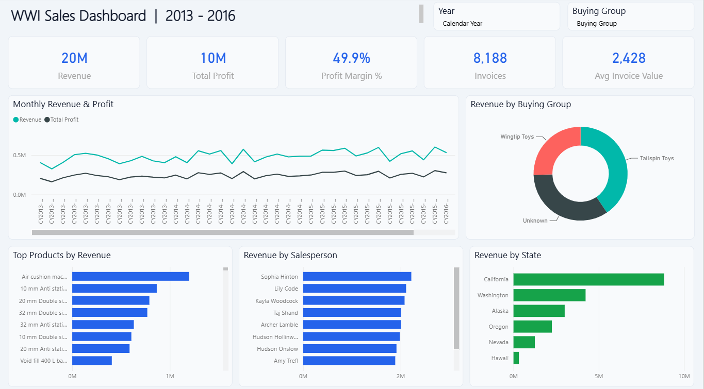
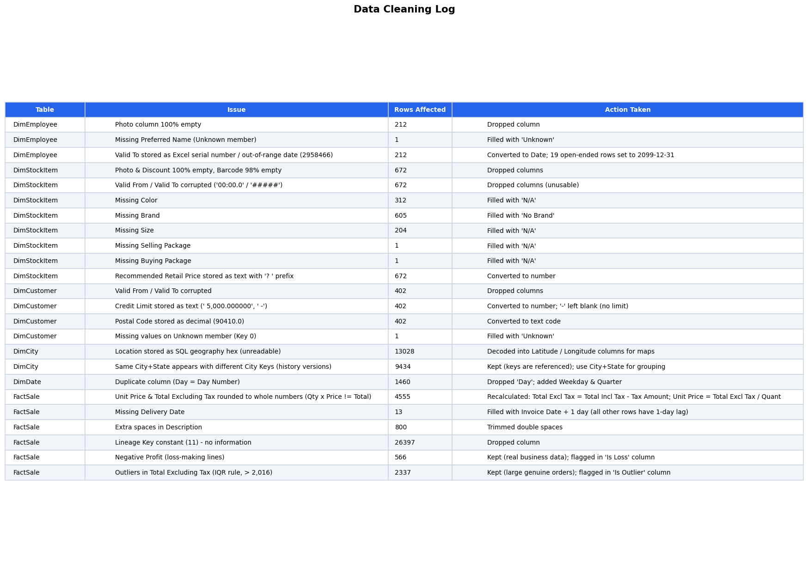
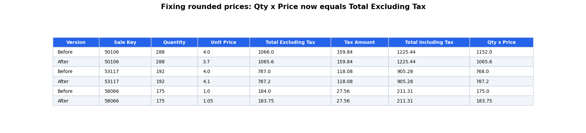
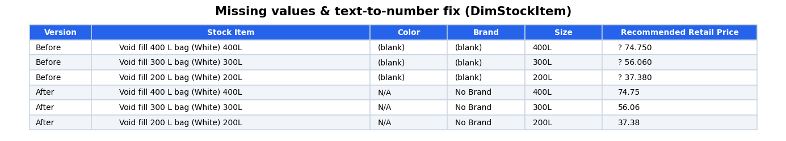
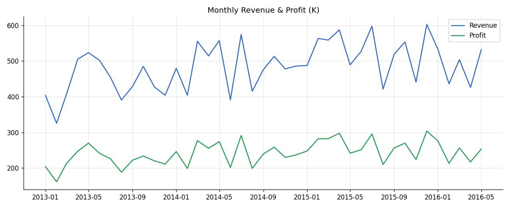
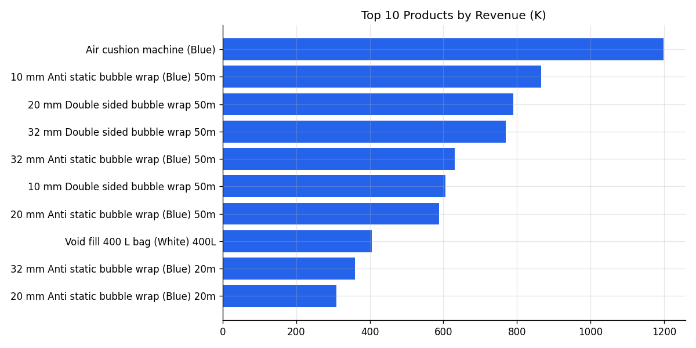

# WWI Sales Analysis

Midterm project. Sales data for Wide World Importers (2013 - 2016), a company that sells packaging and gift items to shops.

Steps:
1. Clean the data in Excel
2. EDA
3. Power BI dashboard

## Files

- `data/raw` - original data and the project pdf
- `data/cleaned/Cleaned_Data.xlsx` - cleaned data (the "Cleaning Log" sheet has every change)
- `analysis/EDA_Notebook.ipynb` - EDA in Python
- `analysis/EDA_Analysis.xlsx` - EDA tables
- `analysis/charts` - charts
- `powerbi/WWI_Sales_Dashboard.pbix` - dashboard
- `scripts/clean_and_eda.py` - cleaning code

## Cleaning

- Unit Price and Total Excluding Tax were rounded in 4,555 rows, so I recalculated them from Total Including Tax - Tax Amount.

- Filled missing Color, Brand and Size, and changed prices from text to numbers.

- Filled 13 missing delivery dates (invoice date + 1 day).
- Fixed date columns and changed the Location column to latitude and longitude.
- Removed extra spaces and empty columns.
- No duplicates found.

## EDA

- Revenue: 19.88M, Profit: 9.92M, Margin: 49.9%
- 8,188 invoices, average invoice 2,428
- Data is right skewed (median 227, mean 753)
- 2,337 outliers by IQR. I kept them because they are real big orders.

## Insights

- Revenue grows about 10% every year.
- Packaging products sell the most.
- Halloween masks are always sold at a loss.
- 34% of sales have no customer name.
- California is 44% of revenue.
- No sales on Sunday.

## Tools

Excel, Python (pandas, matplotlib), Power BI
