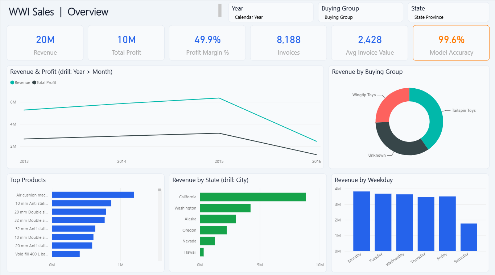
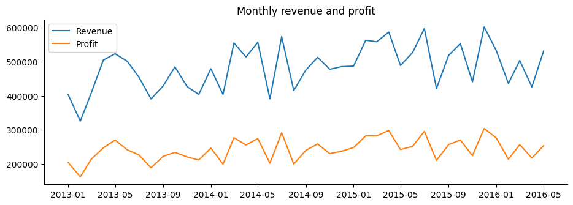
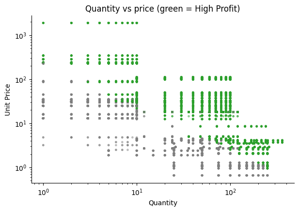
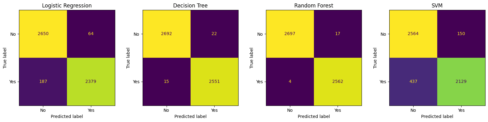
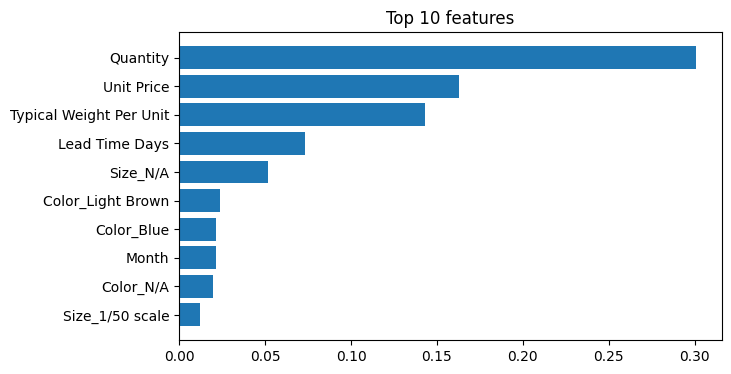
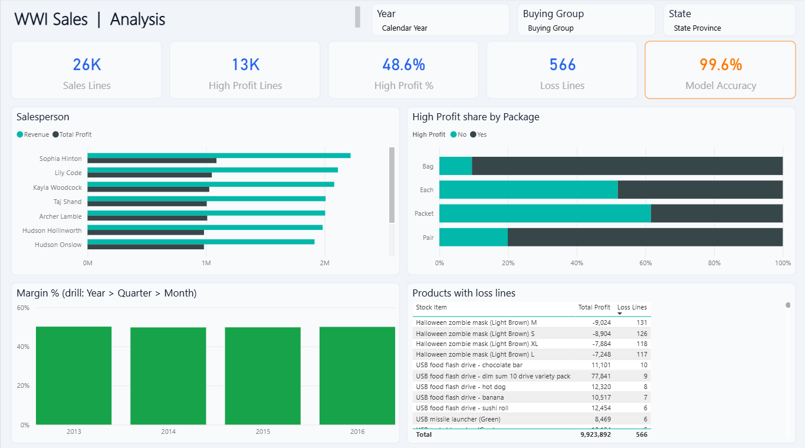
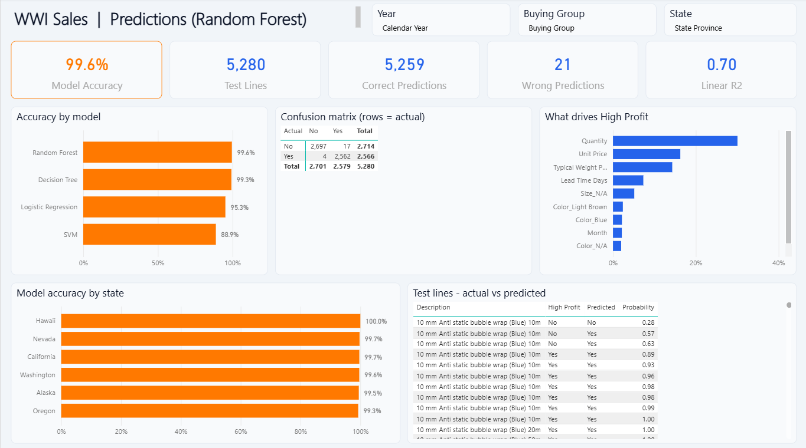

# WWI Sales - Part 2 (Final Project)

Part 1 (the midterm) answered "what happened?". In Part 2 I used the same data to answer "what happens next?": will a sale be **High Profit** or not.

What's new in Part 2:
1. Cleaning in Python, with outlier checks (IQR and Z-score) and new columns
2. 5 ML models to predict High Profit
3. Insights and recommendations
4. Dashboard grew from 1 page to 3 pages, with the model accuracy on every page

## Files

- `data/raw` - original data and the project pdf
- `data/cleaned/Cleaned_Data.xlsx` - cleaned data with a "Cleaning Log" sheet
- `data/cleaned/sales_model.csv` - one table for the models
- `notebooks/01_cleaning_eda.ipynb` - cleaning and EDA
- `notebooks/02_models.ipynb` - the models
- `notebooks/03_ai_insights.ipynb` - insights written from the numbers
- `models` - results, predictions and confusion matrix (used in Power BI)
- `insights/AI_Insights.md` - insights and recommendations
- `powerbi/WWI_Final_Dashboard.pbix` - dashboard

## Cleaning

- 4,555 rows had rounded Unit Price and Total, I recalculated them.
- Filled missing Color, Brand, Size and 13 delivery dates.
- Fixed types (prices stored as text, dates as numbers).
- No duplicates.
- Outliers: 2,337 by IQR and 642 by Z-score. I kept them (real big orders) and only capped Quantity for the models.
- New columns: Delivery Days, Year, Month, Weekday and the target High Profit (profit > median 120).

## EDA

- Revenue 19.88M, profit 9.92M, margin 49.9%
- Sales grow about 10% a year
- No sales on Sunday
- California is 44% of revenue
- Halloween masks make most of the losses

## Models

The model gets 15 inputs (quantity, price, item, customer group, state, month, weekday...). Profit and Total are not inputs. 80% of the data to learn and 20% (5,280 sales) to test.

| Model | Result |
|---|---|
| Random Forest | 99.6% accuracy |
| Decision Tree | 99.3% |
| Logistic Regression | 95.3% |
| SVM | 88.9% |
| Linear Regression (profit value) | R2 0.70 |

Random Forest is the best, only 21 wrong out of 5,280. The accuracy is high because profit depends mostly on quantity and unit price.

## Dashboard

3 pages: Overview, Analysis and Predictions. Every page has the model accuracy card, filters for Year, Buying Group and State, and drill down (Year > Month, State > City).

## Recommendations

- Push bigger orders, quantity is the main driver of high profit
- Fix the price of Halloween masks or stop them (492 of the 566 loss lines)
- Check orders with the model before confirming them
- Promotion in August, stock up for July

## Tools

Python (pandas, scikit-learn, matplotlib), Power BI, Generative AI
